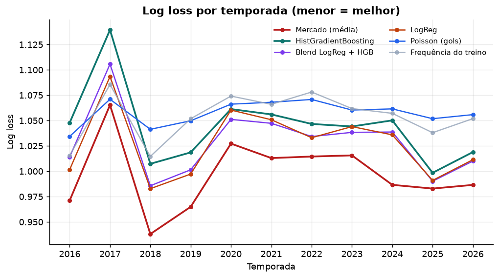
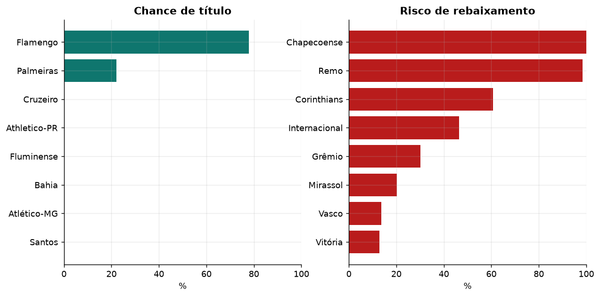
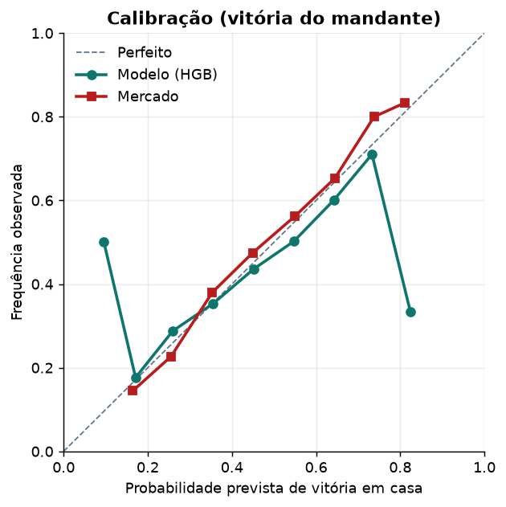
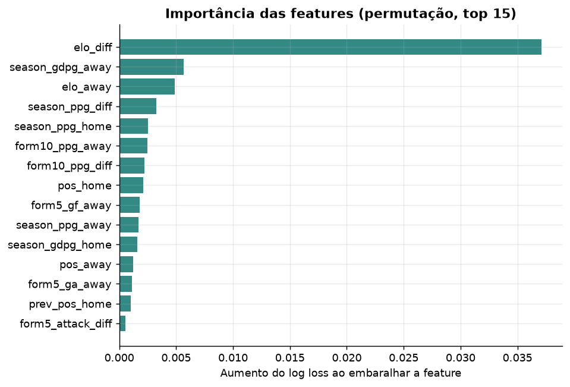

# ⚽ Brasileirão Série A — previsão de resultados com Machine Learning

Projeto de portfólio que prevê o resultado de partidas do Campeonato Brasileiro Série A
(vitória em casa, empate ou vitória fora) e simula o restante da temporada.

O objetivo **não** é "bater o mercado". É construir um pipeline completo e honesto:
features causais, validação que respeita o tempo, benchmark contra odds de fechamento e
um dashboard interativo. O resultado principal é justamente o que quase ninguém mostra em
projeto de portfólio: **um modelo bem-feito chega perto do mercado, mas não o supera.**

---

## Resumo

| | |
|---|---|
| **Dados** | 5.646 partidas · 2012–2026 · football-data.co.uk |
| **Alvo** | 1X2 (casa / empate / fora) |
| **Validação** | walk-forward por temporada (teste em 2016–2026, 4.126 jogos) |
| **Features** | 32, todas calculadas só com informação disponível antes do jogo |
| **Melhor modelo** | LogReg com Elo — log loss **1,021** |
| **Benchmark** | mercado (odds de fechamento) — log loss **0,997** |
| **Conclusão** | o mercado vence, com diferença estatisticamente significativa |
| **Dashboard** | Streamlit com simulador de partida, tabela projetada e explorador de times |
| **Site** | React + TypeScript + Tailwind, com dados estáticos e sem backend |



---

## Resultados

Validação walk-forward: para cada temporada, o modelo treina apenas com o passado e prevê a
temporada inteira. Métricas calculadas nas 4.126 partidas de 2016–2026 que têm odds.

| # | Modelo | Acurácia | Log loss ↓ | Brier ↓ | RPS ↓ |
|---|--------|---------:|-----------:|--------:|------:|
| 1 | **Mercado (média das odds)** | 51,4% | **0,9970** | **0,5963** | **0,2001** |
| 2 | LogReg (só Elo) | 49,3% | 1,0208 | 0,6122 | 0,2075 |
| 3 | LogReg (32 features) | 49,0% | 1,0276 | 0,6169 | 0,2092 |
| 4 | Blend LogReg + HGB | 49,1% | 1,0291 | 0,6176 | 0,2094 |
| 5 | HistGradientBoosting | 48,1% | 1,0448 | 0,6268 | 0,2126 |
| 6 | Frequência do treino (baseline) | 47,8% | 1,0541 | 0,6354 | 0,2187 |
| 7 | Poisson de gols | 47,8% | 1,0574 | 0,6376 | 0,2198 |

Alguns pontos que valem mais que a tabela:

- **O mercado é muito forte.** Ele acerta 51,4% e tem a melhor probabilidade, mesmo sem
  saber escalação, lesão ou arbitragem.
- **Menos features foi melhor.** O LogReg só com Elo bateu o LogReg com 32 features. Com
  ~4 mil partidas de treino, isso é sinal de que a maior parte das features adiciona ruído.
- **O baseline "sempre casa" acerta 47,8%**, mas tem log loss péssimo. Acurácia sozinha
  engana: o modelo precisa ser bom em probabilidade, não só no palpite.
- **O HGB sobreajusta.** Só ficou competitivo com árvores minúsculas (4 folhas, `lr=0,03`,
  `l2=10`); mesmo assim, não superou a regressão logística.

### Backtest: o modelo contra o mercado

| Benchmark | Δ log loss (modelo − mercado) | IC 95% | Veredito |
|-----------|------------------------------:|--------|----------|
| Média do mercado | +0,0306 | [+0,0231, +0,0381] | modelo pior (significativo) |
| Pinnacle (fechamento) | +0,0318 | [+0,0237, +0,0398] | modelo pior (significativo) |
| Melhor preço | +0,0307 | [+0,0231, +0,0381] | modelo pior (significativo) |

O intervalo de confiança é calculado por **bootstrap pareado por partida** (4 mil
reamostragens). Como o IC não cruza zero, a diferença não é sorte de amostra.

### E se o modelo apostasse?

Estratégia: apostar 1 unidade no resultado com maior valor esperado (`p_modelo × odd − 1`),
sempre que esse valor passar de um limite.

| Benchmark | Apostas | ROI do modelo | ROI do placebo* |
|-----------|--------:|-------------:|----------------:|
| Média do mercado | 3.772 | −9,7% | — |
| Pinnacle | 3.667 | −6,2% | — |
| Melhor preço | 4.104 | −2,1% | +1,5% |

\* Placebo = apostar com as probabilidades do próprio mercado.

O ROI negativo é a confirmação final: se o modelo tivesse vantagem real, apostar com
"valor" daria lucro. O único ROI positivo é o do placebo no *melhor preço*, que é
simplesmente **line shopping** (escolher a melhor cotação entre casas), não habilidade
preditiva. Todos os ROIs somem quando se usa a Pinnacle, o benchmark mais duro
(overround de ~3,1% contra ~6,8% da média).

---

## O vazamento de dados que quase virou resultado

Esta é a parte mais importante do projeto — e a que mais rende conversa em entrevista.

Na primeira versão, o modelo **batia a Pinnacle com ROI de +19%**. Isso é implausível:
odds de fechamento incorporam muita informação. Antes de comemorar, tratei como bug.

**Como o problema apareceu**

- ROI de +12% a +26% em milhares de apostas, inclusive contra a Pinnacle.
- A família de features "temporada/posição" sozinha tinha log loss 0,9807 — *melhor que o
  modelo completo* e melhor que o mercado.
- A feature `prev_pos_home` (posição na temporada anterior) correlacionava **0,942** com os
  pontos finais da temporada corrente. Isso é impossível para uma informação do passado.

**A causa**

`_previous_season_positions` montava a tabela final de cada temporada e associava essa
posição à **mesma** temporada, em vez da seguinte. Na prática, o modelo sabia onde o time
terminaria o campeonato antes de ele começar.

Auditoria manual: o Palmeiras de 2024 recebia `prev_pos = 2` (sua posição final em 2024),
mas havia terminado 2023 em **1º lugar**.

**A correção**

Uma linha: a tabela final da temporada `S` passa a valer a partir de `S+1`.

```python
table["season"] = season + 1  # conhecida a partir da temporada seguinte
```

**A proteção**

`tests/test_no_leakage.py` tem cinco testes, incluindo um corte no meio de 2020: as
features dos jogos anteriores ao corte precisam ser **idênticas** às calculadas com o
dataset inteiro. Validei que o teste falha com o bug antigo e passa com a correção.

> Lição: métrica boa demais é sintoma, não troféu. O ROI "impossível" foi o que levou ao bug.

---

## Como o modelo é construído

```
football-data.co.uk/BRA.csv
        │  scripts/download_data.py
        ▼
data/raw/brasileirao.csv
        │  build_features()  (32 features causais)
        ▼
data/processed/matches_features.csv
        │  walk_forward()  (treina < S, testa S)
        ▼
reports/metrics.csv · predictions_walkforward.csv · figures/
        │  fit final + Poisson + Monte Carlo
        ▼
models/final_model.joblib  →  app/dashboard.py
        │  scripts/export_web_data.py
        ▼
web/public/data/*.json  →  web/ (site React)
```

### Features (32)

| Família | Exemplos |
|---------|----------|
| Elo | `elo_home`, `elo_away`, `elo_diff`, `elo_home_adv` |
| Forma recente | pontos/jogo e gols nos últimos 5 e 10 jogos |
| Temporada | pontos/jogo, saldo/jogo, posição na tabela |
| Contexto | dias de descanso, time recém-promovido, rodada |
| Histórico | posição final na temporada anterior |

Todas seguem a mesma regra: **um jogo só pode usar partidas anteriores a ele.**

- Elo: um único passe cronológico, atualizado depois do jogo (K=20, vantagem de casa de 60
  pontos, multiplicador por saldo e regressão de 25% entre temporadas).
- Médias móveis: `shift(1)` antes do `rolling`.
- Posição na tabela: snapshot por data, com o estado conhecido antes da rodada.
- Posição anterior: tabela final da temporada `S−1`, nunca da `S`.

### Validação walk-forward

Treinar com uma temporada aleatória e testar em outra vaza informação (o futuro influencia
o passado). Aqui, para cada temporada `S` de 2016 a 2026:

```
treino = todas as partidas com season < S
teste  = todas as partidas da temporada S
```

Isso reproduz o uso real: prever o campeonato antes de ele acontecer.

### Métricas

- **Log loss** (principal): pune probabilidades confiantes e erradas. É a métrica adequada
  quando o objetivo é probabilidade, não palpite.
- **Brier**: erro quadrático multiclasse.
- **RPS** (*Ranked Probability Score*): explora a ordem casa > empate > fora.
- **Acurácia**: só para comunicação; ignora a confiança da previsão.

### Modelo de gols (Poisson)

Versão simples do modelo de Maher (1982):

```
λ_casa = exp(μ + vantagem_casa + força_casa − força_fora)
λ_fora = exp(μ − vantagem_casa + força_fora − força_casa)
```

As forças são estimadas por regressão Poisson com **peso exponencial no tempo**
(half-life de 540 dias), para que partidas antigas pesem menos. A matriz de placares
alimenta a simulação Monte Carlo do campeonato.

### Simulação da temporada

10 mil simulações dos 53 jogos restantes de 2026, com desempate por pontos → saldo → gols
pró. A simulação usa o Poisson de gols (não o classificador 1X2).

| Time | Pos. atual | Pts atuais | Pts projetados | Título | G4 | Queda |
|------|-----------:|-----------:|---------------:|-------:|---:|------:|
| Flamengo | 1 | 73 | 80,4 | **77,9%** | 100% | 0% |
| Palmeiras | 2 | 70 | 77,3 | 22,1% | 100% | 0% |
| Cruzeiro | 3 | 57 | 64,1 | 0% | 78,2% | 0% |
| Athletico-PR | 5 | 54 | 61,0 | 0% | 47,8% | 0% |
| Fluminense | 4 | 54 | 60,7 | 0% | 43,0% | 0% |
| Bahia | 6 | 53 | 59,6 | 0% | 24,6% | 0% |



---

## Dashboard

```bash
streamlit run app/dashboard.py
```

Quatro abas:

1. **Simulador de partida** — probabilidades 1X2 de quatro modelos, gols esperados e os
   placares mais prováveis.
2. **Tabela simulada** — projeção de título, G4 e rebaixamento com barras de progresso.
3. **Desempenho** — métricas walk-forward, backtest, bootstrap e figuras.
4. **Explorador de times** — Elo, forma, posição e últimos jogos.




---

## Site (frontend)

O site é a versão de produção do projeto: React 19 + TypeScript + Tailwind v4 + Vite, com
Recharts e Framer Motion. Ele consome apenas JSON estático gerado pelo pipeline — não precisa
de servidor Python rodando.

Seções:

1. **Hero** — confronto em destaque, probabilidades, gols esperados e favorito ao título.
2. **Simulador 1X2** — os 380 confrontos possíveis, quatro modelos, gols esperados, matriz de
   placares e comparação lado a lado.
3. **Tabela projetada** — pontos médios, faixa P5–P95 e probabilidades de título, G4 e Z4.
4. **Desempenho** — log loss por temporada, calibração, permutation importance, matriz de
   confusão, backtest e ROI.
5. **Times** — Elo dos últimos anos, forma, últimos jogos e estatísticas de cada clube.
6. **Método** — pipeline, ficha técnica e limitações.

Os dados vêm de `scripts/export_web_data.py`, que usa os mesmos modelos e relatórios do
dashboard para gerar `web/public/data/*.json`: metadados, tabela, simulação, 380 confrontos,
histórico dos times, métricas, backtest, calibração e matriz de confusão.

---

## Como rodar

Requisitos: Python 3.11+ (testado em 3.13) e git.

```bash
git clone <url-do-repo>
cd brasileirao-ml

python -m venv .venv
# Windows
.venv\Scripts\activate
# Linux/macOS
source .venv/bin/activate

pip install -r requirements-dev.txt
pip install -e .

python scripts/download_data.py   # baixa ~690 KB do football-data.co.uk
python scripts/train.py           # features, walk-forward, figuras, modelo e simulação
python scripts/backtest.py        # benchmark contra o mercado + bootstrap + apostas
streamlit run app/dashboard.py
```

Testes:

```bash
python -m pytest
```

O `train.py` leva cerca de um minuto. Ele gera `data/processed/`, `models/` e `reports/`;
por isso esses artefatos maiores não são versionados.

### Frontend

Requisitos: Node 20+. Com o pipeline já executado:

```bash
python scripts/export_web_data.py   # gera web/public/data/*.json
npm --prefix web install
npm --prefix web run dev            # desenvolvimento em http://localhost:5173
npm --prefix web run build          # build de produção em web/dist
npm --prefix web run preview        # serve o build localmente
```

O build usa `base: "./"`, então funciona tanto em domínio próprio quanto em uma subpasta do
GitHub Pages. Para publicar, basta enviar o conteúdo de `web/dist` para o serviço de
hospedagem estática (GitHub Pages, Vercel ou Netlify). O site não faz chamadas a nenhum
backend — só lê os JSONs de `web/public/data`.

### Estrutura

```
brasileirao-ml/
├── app/
│   └── dashboard.py          # app Streamlit (4 abas)
├── data/
│   ├── raw/                  # BRA.csv original
│   └── processed/            # features (gerado)
├── models/                   # modelo final (gerado)
├── reports/
│   ├── figures/              # gráficos versionados
│   └── *.csv                 # métricas, backtest e simulação
├── scripts/
│   ├── download_data.py
│   ├── train.py
│   ├── backtest.py
│   └── export_web_data.py    # gera os JSONs do site
├── src/brasileirao_ml/
│   ├── config.py             # caminhos e constantes
│   ├── data.py               # leitura, limpeza, odds, tabela
│   ├── features.py           # Elo, forma, posição (features causais)
│   ├── models.py             # especificações dos modelos
│   ├── evaluate.py           # métricas e walk-forward
│   ├── poisson.py            # gols, fixtures e Monte Carlo
│   └── plots.py              # figuras
├── web/                      # site React (frontend de produção)
│   ├── public/data/          # JSONs gerados pelo pipeline
│   └── src/                  # componentes, tipos e estilos
└── tests/
    ├── test_no_leakage.py    # causalidade das features
    └── test_dashboard_smoke.py
```

---

## Limitações (e o que eu faria depois)

- **Só o resultado 1X2.** Não modelo placar exato de forma competitiva; a matriz Poisson é
  usada para simular, não para apostar em placar.
- **Sem informação de elenco.** Lesões, suspensões, troca de técnico e viagens não entram.
  É parte do motivo de o modelo não bater o mercado.
- **Odds como benchmark, não como feature.** Usar odds no treino melhoraria a previsão,
  mas tornaria o exercício circular. Para produção, um blend modelo + mercado é o caminho.
- **2026 em andamento.** A simulação parte da tabela atual e assume forças constantes até o
  fim do campeonato.
- **Poisson simples.** Um modelo Dixon–Coles (correlação entre gols dos dois times) ou um
  modelo com xG seria o próximo passo natural.
- **Sem calibração pós-hoc.** Isotonic/Platt por temporada poderia reduzir o log loss, mas
  precisa de validação própria para não vazar.

Próximos passos que eu consideraria: Dixon–Coles, features de xG, modelo hierárquico
Bayesiano para times com poucos jogos, calibração out-of-fold e integração com uma API de
odds para prever jogos futuros com mercado.

---

## Referências

- [football-data.co.uk](https://www.football-data.co.uk/brazil.php) — resultados e odds.
- Maher, M. J. (1982). *Modelling association football scores*. Statistica Neerlandica.
- Dixon, M. J., & Coles, S. G. (1997). *Modelling association football scores and
  inefficiencies in the football betting market*. JRSS-C.
- Elo, A. E. (1978). *The Rating of Chessplayers, Past and Present*.

---

Projeto feito para portfólio. Se quiser trocar ideia sobre modelagem, validação ou o
vazamento, é só abrir uma issue.
